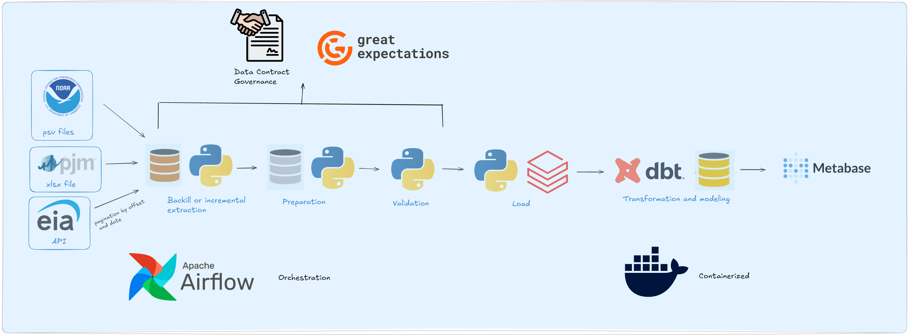

# Virginia Energy Data Pipeline

This project brings together electricity demand, weather, prices, and load forecasts to explore how demand changes in the PJM Dominion region. 

The pipeline takes data from the EIA API and local NOAA and PJM files through Python processing and Databricks storage to dbt models and Metabase visualizations. The aim is to make these sources easier to analyze together while preserving missing observations and the different versions of each forecast.

## Data covered

The sources and quality rules are defined in the [data contract](data/config/data_contract.yml):

| Source | Data | Coverage |
| --- | --- | --- |
| EIA API | Hourly electricity demand | PJM Dominion region |
| EIA API | Monthly residential electricity prices | Virginia |
| NOAA files | Weather observations | Dulles station |
| PJM workbook | Historical July peaks and forecasts by release year | DOM sheet, labeled VEPCO |

## How the pipeline works



The data moves through three layers: **bronze** for raw API responses and files, **silver** for prepared and validated tables, and **gold** for analytical models.

1. **Collect the source data.** Python retrieves EIA records in date windows and paginates through each response. The first extraction backfills history; later runs use saved checkpoints and revisit recent periods to capture revisions. NOAA weather files and the PJM workbook are supplied locally.

2. **Prepare and validate.** pandas standardizes columns and data types and keeps the latest overlapping API records. A YAML data contract defines the expected structure and quality thresholds. Great Expectations checks the prepared data, and a failed validation blocks that source from loading.

3. **Load Databricks.** Validated records are merged into Delta tables using the keys defined in the contract. Existing records are updated and new ones inserted, allowing the pipeline to rerun without duplicating those records.

4. **Build the analytical models.** dbt builds and tests two gold tables: an hourly demand dataset with weather, price context, and missing-data flags; and a forecast accuracy dataset comparing each forecast version with the recorded July peak.

5. **Explore in Metabase.** The gold tables support seasonal demand charts, weekday and weekend comparisons, temperature analysis, and forecast error comparisons.

Airflow runs extraction, preparation and loading, and the dbt build in order, on a quarterly schedule once the DAG is enabled. Docker Compose runs Airflow, Metabase, and their PostgreSQL metadata databases; the analytical data lives in Databricks.

## Explore the results

[Results and visualizations](docs/RESULTS.md) explains the patterns behind the charts: demand rises at both temperature extremes, weekends soften the morning ramp, and the 2025 forecast revision moved away from the eventual actual peak.

The results also explain the scope of each dataset. Regional demand does not isolate data center consumption, residential prices provide context rather than data center tariffs, and the workbook peak series needs reconciliation before direct comparison with regional hourly demand.

## How to run

You'll need Docker with Docker Compose, an EIA API key, and a Databricks SQL warehouse with access to create and update the project's tables. Run the commands from the repository root.

1. Copy `.env-example` to `.env`. Set `EIA_KEY`, `DATABRICKS_KEY`, `DATABRICKS_HOSTNAME`, and `DATABRICKS_HTTP`. Add `DATABRICKS_CATALOG`, `DATABRICKS_SCHEMA` (for example, `silver`), and `METABASE_DB_PASSWORD`, which are required but missing from the example file. On Linux or WSL, set `AIRFLOW_UID` to the output of `id -u`.

2. Place the NOAA files and PJM workbook listed in the [data contract](data/config/data_contract.yml) in `data/raw/`. Keep the EIA raw files and `data/config/eia_state.json` together when resuming an extraction. For a fresh backfill, start without the checkpoint file.

3. Build and start the services:

   ```bash
   docker compose up -d --build
   ```

4. Open [Airflow at localhost:8080](http://localhost:8080) and sign in using the credentials from its startup output. You can inspect that output with:

   ```bash
   docker compose logs airflow
   ```

   Enable the `Complete_Pipeline` DAG and trigger a run. It ends with the dbt build and tests; future runs follow the quarterly schedule.

5. After the run succeeds, open [Metabase at localhost:3000](http://localhost:3000), complete setup, and connect it to the Databricks SQL warehouse. Explore the two tables in the `gold` schema to create questions and charts. The screenshots in the results document are examples; dashboards are not automatically installed.

To stop the local services while keeping their stored data:

```bash
docker compose down
```
